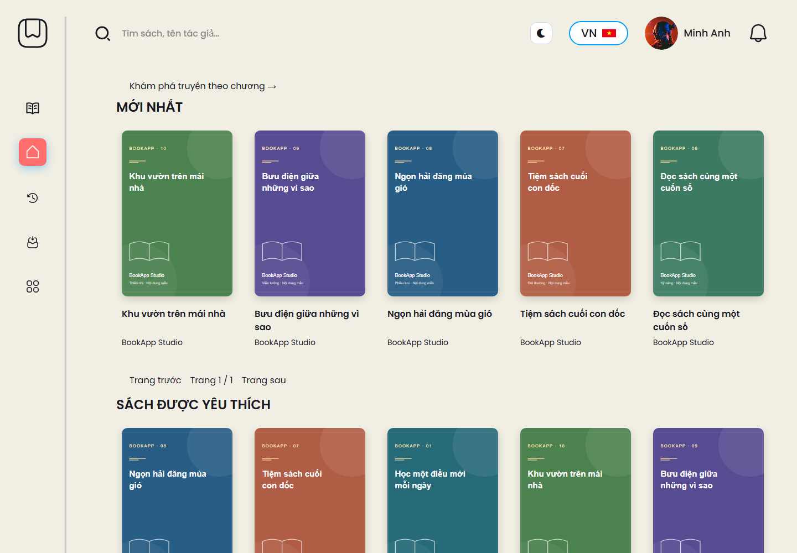

# BookApp

Ứng dụng web đọc sách và truyện theo chương, xây dựng bằng **React, FastAPI và MySQL**. Dự án phục vụ học tập, trình diễn nghiệp vụ fullstack và thử nghiệm AI hỗ trợ đọc sách.

[Kiến trúc và quyết định kỹ thuật](docs/architecture.md) · [Triển khai](docs/deployment.md) · [Kịch bản demo và mô tả CV](docs/portfolio.md) · [Kết quả kiểm chứng](docs/verification.md)



## Chạy demo bằng Docker

Yêu cầu Docker Engine/Desktop có Compose và Python để tạo secret cục bộ. Từ thư mục gốc:

```sh
python scripts/setup_demo.py
docker compose up --build -d
```

Mở **http://localhost:8080**, Swagger tại **http://localhost:8080/docs**. Compose dựng frontend/Nginx, backend, MySQL và Redis; SQL demo chỉ được import khi volume MySQL chưa có dữ liệu. Script giữ nguyên `.env` nếu đã tồn tại. Tài khoản demo ở phần bên dưới.

Upload, database và cache được giữ trong volume khi khởi động lại. `docker compose down` dừng dịch vụ và giữ volume. Cấu hình mặc định chỉ mở cổng trên máy cá nhân; xem [hướng dẫn triển khai HTTPS](docs/deployment.md) trước khi đưa lên Internet.

## Tính năng

- Đăng ký, đăng nhập JWT, phân quyền người đọc/quản trị, hồ sơ cá nhân và đặt lại mật khẩu qua email.
- Tìm sách, lưu vào tủ sách, yêu thích, đánh giá, bình luận và lịch sử đọc.
- Đăng sách PDF; tạo truyện, thêm/sửa/xóa chương và quản lý trạng thái xuất bản.
- Trình đọc phân trang, mục lục, tùy chỉnh phông/cỡ chữ và giao diện sáng/tối/sepia.
- Đồng bộ tiến độ bằng phiên bản server; cho chọn vị trí khi có xung đột giữa các phiên đọc.
- Tô sáng, ghi chú và quay lại đoạn nguồn; bản nháp chương tự lưu trên thiết bị theo tài khoản.
- Hỏi đáp/tóm tắt với Gemini, kiểm tra trích dẫn dựa trên nội dung nguồn và lưu câu trả lời thành ghi chú.
- Nghe đọc bằng Edge TTS với giọng Hoài My/Nam Minh, điều chỉnh tốc độ, tạm dừng và tự chuyển trang/chương.
- Admin có biểu đồ dữ liệu thật, bộ lọc thời gian, tìm kiếm/phân trang và quản lý sách, người dùng, bình luận.

## Công nghệ và cấu trúc

| Thành phần | Công nghệ |
| --- | --- |
| Frontend | React 19, React Router 7, Vite 8, Tailwind CSS 4, Axios |
| Backend | FastAPI, SQLAlchemy 2 async, aiomysql, Pydantic, JWT, SlowAPI |
| Dữ liệu | MySQL 8, PDF/văn bản HTML, Pillow, pypdf |
| AI và âm thanh | Gemini API, edge-tts, HTML Audio |
| Kiểm thử | Python unittest/httpx, Node.js test runner, Playwright, Oxlint, GitHub Actions |
| Vận hành | Docker Compose, Nginx, Redis, Alembic migrations |

```text
backend/
  app/config/         Cấu hình từ biến môi trường
  app/models/         SQLAlchemy models
  app/routes/         API endpoints
  app/schemas/        Validation và response schemas
  app/services/       Nghiệp vụ
  app/static/seed/    Nội dung và ảnh bìa demo được đưa lên Git
  tests/              Kiểm thử API, dữ liệu và dịch vụ
  .env.example        Cấu hình mẫu, không chứa khóa thật
  bookapp.sql         Schema và dữ liệu demo
  migrate.py          Entrypoint chạy Alembic đến phiên bản mới nhất
  migrations/         Các phiên bản migration; giữ nguyên dữ liệu đang có
  reset_demo_data.py  Công cụ làm mới/xuất dữ liệu demo
frontend/
  public/images/      Asset giao diện
  src/api/            HTTP client
  src/components/     Thành phần giao diện
  src/context/        Authentication và theme
  src/pages/          Trang người đọc và admin
  src/styles/         CSS
  src/utils/          Tiện ích và kiểm thử frontend
.github/workflows/    Kiểm thử và build tự động
```

## Yêu cầu

- Python **3.11+**, khuyến nghị **3.12**.
- Node.js **20.19+ trong nhánh 20 hoặc 22.12+**, kèm npm.
- MySQL **8.0+**.
- Internet để dùng Edge TTS, Gemini và tải font/icon từ CDN. Gemini/email cần cấu hình riêng; các chức năng đọc sách cơ bản không cần API key.

## Chạy trên máy cá nhân

### 1. Chuẩn bị MySQL

Tạo một database riêng để chạy demo:

```sql
CREATE DATABASE IF NOT EXISTS bookapp CHARACTER SET utf8mb4 COLLATE utf8mb4_unicode_ci;
```

Import `backend/bookapp.sql` bằng MySQL Workbench hoặc MySQL CLI. Ví dụ trong **Bash/Command Prompt**, từ thư mục gốc:

```sh
mysql -u root -p bookapp < backend/bookapp.sql
```

**SQL demo có lệnh DROP TABLE, sẽ thay dữ liệu trong các bảng ứng dụng. Chỉ import vào database demo hoặc sau khi đã sao lưu dữ liệu cần giữ.** Giữ nguyên `backend/app/static/seed/` vì SQL tham chiếu các file trong thư mục này.

### 2. Khởi động backend

Ví dụ trên Windows PowerShell:

```powershell
cd backend
py -3.12 -m venv .venv
.\.venv\Scripts\Activate.ps1
python -m pip install -r requirements.lock
Copy-Item .env.example .env
```

Chỉnh `backend/.env`: điền kết nối MySQL và thay `JWT_SECRET_KEY` bằng giá trị ngẫu nhiên riêng. Để `FLASK_SECRET_KEY` trống nếu không cần tương thích cấu hình cũ. Giữ `.env` trên máy, không commit lên GitHub. `requirements.lock` khóa phiên bản dependency đã kiểm thử; `requirements.txt` ghi khoảng phiên bản dùng khi chủ động nâng cấp.

Sau khi import SQL và cấu hình `.env`:

```powershell
python migrate.py
python main.py
```

Linux/macOS dùng `python3.12 -m venv .venv`, `source .venv/bin/activate` và `cp .env.example .env`, sau đó chạy cùng các lệnh Python. Migration cần quyền CREATE/ALTER và có thể chạy lại.

### 3. Khởi động frontend

Mở terminal khác từ thư mục gốc:

```sh
cd frontend
npm ci
npm run dev
```

| Dịch vụ | Địa chỉ |
| --- | --- |
| Giao diện | http://localhost:5173 |
| Backend | http://127.0.0.1:5000 |
| Swagger | http://127.0.0.1:5000/docs |
| Health check | http://127.0.0.1:5000/health |

Vite chuyển tiếp `/api`, `/static`, `/health` tới backend ở cổng 5000. Khi deploy, cần cấu hình reverse proxy và đường dẫn SPA tương ứng; `npm run build` tạo bản frontend trong `frontend/dist`.

## Bộ demo và tài khoản

Bộ dữ liệu gồm **6 sách, 4 truyện với 16 chương, 10 ảnh bìa, 20 đánh giá, 6 bình luận**, kèm tủ sách, ghi chú và tiến độ mẫu. Nội dung trong `seed_catalog.py` được biên soạn làm dữ liệu demo BookApp Studio.

| Email | Mật khẩu demo | Vai trò |
| --- | --- | --- |
| admin@bookapp.vn | Admin@12345 | Quản trị |
| reader@bookapp.vn | Reader@12345 | Người đọc có tủ sách/ghi chú mẫu |
| linh@bookapp.vn | Reader@12345 | Người đọc |

Các tài khoản trên là tài khoản công khai cho demo. Thay tài khoản và secret trước khi triển khai cho người dùng thật.

Công cụ trong `backend`:

```powershell
# Xóa toàn bộ dữ liệu ứng dụng, gồm tài khoản, rồi tạo lại demo.
python reset_demo_data.py --reset-all

# Chỉ xuất database hiện tại sang bookapp.sql, không reset database.
python reset_demo_data.py --export-only
```

Lệnh reset ghi bản sao dữ liệu và file cũ vào `backend/backups/` trước khi thay dữ liệu trong transaction. Backup chỉ giữ cục bộ. Không xuất lại SQL để commit sau khi đã nhập tài khoản hoặc nội dung riêng tư vào database.

## AI và giọng đọc

**Gemini:** đặt `GEMINI_API_KEY` và model phù hợp trong `.env`. Backend yêu cầu đăng nhập, giới hạn yêu cầu, tự lấy nội dung nguồn và lọc trích dẫn không xuất hiện trong nguồn. Khi thiếu cấu hình hoặc dịch vụ lỗi, ứng dụng trả thông báo; không tạo câu trả lời mẫu thay thế.

**Email/OTP:** cấu hình SMTP qua các biến MAIL trong `.env.example`. Không cần bật email để đăng nhập bằng tài khoản demo.

**Nghe đọc:** trong reader, mở **Nghe đọc**, chọn **Hoài My · Nữ** hoặc **Nam Minh · Nam**, chọn tốc độ và nhấn **Đọc trang này**. Dừng trước khi đổi giọng/tốc độ. Đổi trang thủ công hoặc rời reader sẽ hủy tải và âm thanh cũ. Nếu trình duyệt chặn tự phát, nhấn đọc lại để tiếp tục.

Edge TTS chạy ở backend, không cần API key và không phụ thuộc giọng cài trong Chrome. **Nội dung đoạn đọc được gửi tới dịch vụ Microsoft khi tạo âm thanh.** Dịch vụ cần Internet; lần tạo đầu có thể mất vài chục giây và có thể gián đoạn. Giao diện báo lỗi để thử lại.

Backend chia văn bản theo câu thành đoạn tối đa 300 ký tự; frontend phát nối đoạn và tải trước một đoạn. Cache riêng ở `backend/.cache/tts/`, dựa trên nội dung/giọng; sửa nội dung tạo khóa cache mới. Cache được dọn khi ghi file mới, hết hạn sau 7 ngày không truy cập, dung lượng mục tiêu tối đa 256 MB. Mỗi tiến trình có tối đa 2 tác vụ tạo âm thanh đồng thời, thời hạn 50 giây và tối đa 8 tác vụ đang chờ/chạy.

## API

Tài liệu chi tiết và schema nằm tại Swagger `/docs`. Các nhóm chính dưới `/api/v1`:

| Nhóm | Chức năng |
| --- | --- |
| `/auth`, `/users` | Authentication, OTP, hồ sơ |
| `/books` | Sách, upload PDF, nội dung và phân trang |
| `/books/catalog` | Tìm theo tên/tác giả, phân trang và xếp theo mới nhất/lượt yêu thích/đánh giá |
| `/stories` | Truyện, chương và trạng thái |
| `/books/{id}/…`, `/history` | Tủ sách, đánh giá, bình luận, tiến độ, ghi chú |
| `/library`, `/books/{id}/comments/page` | Tủ sách và bình luận phân trang phía server |
| `/admin` | Thống kê, quản lý sách/người dùng/bình luận |
| `/ai` | Hỏi đáp và tóm tắt |

Âm thanh: `GET /api/v1/books/{id}/audio?page=0&segment=0&voice=vi-VN-HoaiMyNeural`. Trang/đoạn tính từ 0; có thể truyền `chapter_id`. Header `X-Audio-Segments` trả số đoạn của trang. Endpoint yêu cầu đăng nhập và giới hạn 20 yêu cầu/phút/IP; văn bản lấy từ database, không nhận văn bản tùy ý từ client.

## Kiểm thử

Frontend, từ thư mục `frontend`:

```sh
npm test
npm run lint
npm run build
```

Backend, từ thư mục `backend` đã kích hoạt môi trường ảo:

```sh
python -m pip install -r requirements-dev.lock
python -m unittest discover -s tests -v
```

Để kiểm thử MySQL trên **database tạm riêng** và chạy các luồng trình duyệt:

```sh
# Từ frontend, cài Chromium một lần:
npx playwright install chromium

# Từ backend, dùng kết nối MySQL trong .env có quyền tạo database:
python test_mysql.py --e2e
```

Runner tạo database tên ngẫu nhiên, import demo, kiểm tra migration hai lần, chạy test rồi xóa đúng database tạm đó. Không reset database đang dùng. Thêm `--benchmark` để tạo báo cáo đo local; `--screenshots` để chụp lại ảnh demo từ dữ liệu mẫu. Chi tiết và giới hạn phép đo ở [verification.md](docs/verification.md).

Test AI dùng mock và không gọi Gemini. Các test MySQL mặc định được bỏ qua; bật chúng sau khi import demo, cấu hình `.env` và chạy migration:

```powershell
$env:BOOKAPP_TEST_MYSQL = '1'
python -m unittest discover -s tests -v
```

Test MySQL tạo dữ liệu trong transaction rồi rollback. Test Edge trực tuyến tách riêng, gửi một câu chào mẫu tới Microsoft và có thể thất bại nếu dịch vụ không hoạt động:

```powershell
$env:BOOKAPP_TEST_EDGE_TTS = '1'
python -m unittest discover -s tests -p test_tts.py -v
```

GitHub Actions chạy test/lint/build frontend, test backend với MySQL/Redis riêng, kiểm tra migration chạy lại được và chạy Playwright. Job Docker dựng toàn bộ stack và kiểm tra readiness qua Nginx. CI không gọi Gemini hoặc Edge trực tuyến. Trạng thái workflow trên GitHub chỉ được xác nhận sau khi đẩy repository; chưa có bước tự động publish/deploy.

## Xác thực và vận hành

- Trình duyệt dùng cookie `HttpOnly`, `SameSite=Lax`; token cũ trong web storage được dọn khi ứng dụng mở. Bearer token vẫn dùng được trong Swagger/API client.
- Đăng xuất và đặt lại mật khẩu tăng `token_version` phía server, vô hiệu hóa **mọi phiên đăng nhập của tài khoản**. Mật khẩu plaintext cũ bị từ chối; tài khoản dữ liệu cũ cần đặt lại mật khẩu nếu chưa dùng hash.
- `APP_ENV=production` yêu cầu `DEBUG=false`, secret tối thiểu 32 ký tự, Redis và CORS HTTPS rõ ràng; cookie được đặt `Secure`. Backend từ chối cấu hình không đạt yêu cầu khi khởi động.
- OTP dùng HMAC, hết hạn sau 10 phút, khóa sau 5 lần sai, có khoảng chờ gửi lại 60 giây và chỉ dùng một lần. Redis chia sẻ OTP/rate limit giữa worker; bộ nhớ cục bộ dành cho development.
- HTML sách được đọc/parse ngoài event loop và cache theo đường dẫn, thời gian sửa cùng kích thước file; cache có ngân sách khoảng 16 MiB, tối đa 64 mục mỗi process.
- `/health` kiểm tra process; `/health/ready` kiểm tra MySQL/Redis. API thêm `X-Request-ID`; log request không ghi body, query hoặc thông tin xác thực.

## Giới hạn hiện tại

- Google/Facebook là tính năng “Sắp có”.
- PDF scan không có lớp văn bản chưa được OCR; PDF nhúng không có văn bản trích xuất chưa hỗ trợ nghe đọc và theo dõi trang bên trong trình xem PDF.
- Bản nháp chỉ lưu trên thiết bị hiện tại, không đồng bộ nhiều thiết bị.
- AI có thể trả lời sai; trích dẫn được kiểm tra khớp văn bản nhưng không đảm bảo kết luận đúng.
- Chưa có cam kết độ sẵn sàng của dịch vụ Edge TTS; dự án hiện phù hợp cho demo/học tập.
- Endpoint legacy giữ để tương thích; frontend dùng API danh mục, tủ sách và bình luận phân trang mới. Danh sách truyện, lịch sử và một số danh sách quản trị vẫn cần phân trang server khi dữ liệu lớn.
- Chưa có đồng bộ bản nháp lên cloud, OCR, tìm kiếm toàn văn hoặc đánh giá chất lượng AI trên một tập câu hỏi chuẩn. Kiểm tra trích dẫn là khớp văn bản nguồn, không phải hệ thống RAG/vector search.

## Những file đưa lên Git

Giữ mã nguồn, `backend/.env.example`, `backend/bookapp.sql`, `backend/app/static/seed/`, asset giao diện và `frontend/package-lock.json`. `.gitignore` loại `.env`, môi trường ảo, dependency, bản build, cache, backup, log và file upload cục bộ. Không thêm file nhạy cảm bằng `git add -f`.

Kiểm tra `git status` và diff staged trước khi commit. `.gitignore` không tự bỏ các file đã được theo dõi trong lịch sử Git. Chỉ push khi danh sách commit chứa đúng mã nguồn và dữ liệu demo dự kiến.
